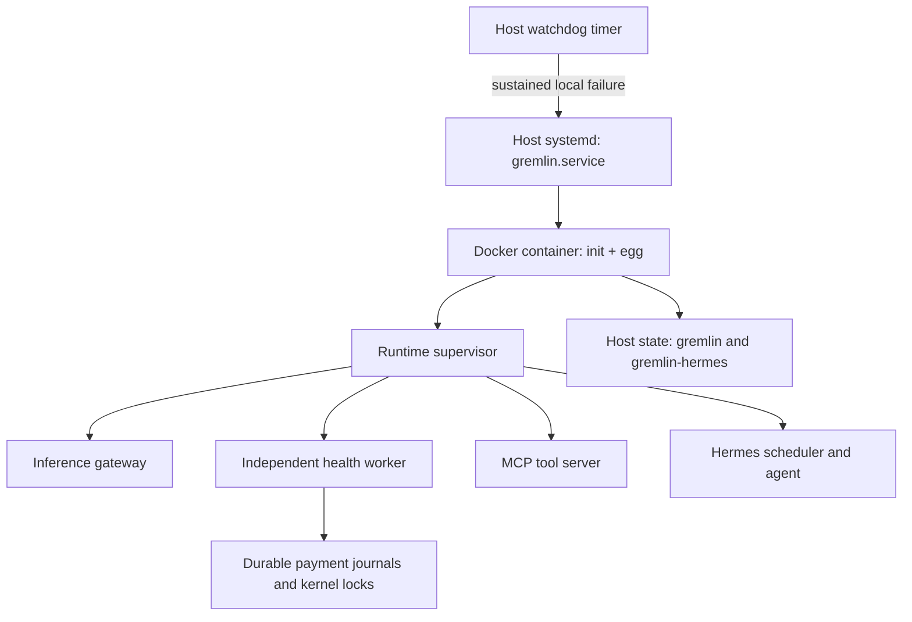

# Single-VM reliability

These changes retain the Docker image and add host systemd supervision. Off-host backups and recovery after loss
of the VM's disk are deferred. The published egg-v0.1.3 image does not contain these changes; a new image and
updated cloud-init must be released before new hosted eggs use them.

Verified locally on 2026-11-12 with Node 24.22.1: 368 main tests in 66 files, 104 board tests in 10 files, the full
workspace/application build, board typecheck, and systemd unit validation passed. Systemd validation mapped the
watchdog executable to a temporary test path; no host units were installed. The recovery test allows thirty
seconds for cold SDK imports under full-suite load; its original ten-second test limit proved too short while
running Docker faults and the full suite together.

The network-isolated Docker harness passed real service startup, Docker health, file ownership, Hermes crash,
MCP freeze, supervisor SIGKILL, container restart, container recreation, and seed/work preservation checks.
The tested local tag is `gremlins/egg:reliability-dev`, image ID
`sha256:2f7e468d5bc2981eecfe6940fe54a5a23e33934894f30fa31efc8c42854eae5e`.
No hosted VM rollout, real VM reboot, or live provider payment was performed.

## Recovery ownership



Systemd runs the attached Docker command with `Restart=always`. This also handles a nest's successful exit after
restoring a gremlin: the next start enters egg mode. `systemctl stop gremlin.service` stays stopped. Docker uses
`--restart=no`, so there is one owner for container restarts. The unit wants Docker but does not require it: a
Docker daemon failure must not silently deactivate the egg's restart policy. Restart delay is 10 seconds, with
five starts per five minutes. The watchdog can clear a failed start limit after its recovery cooldown.

Inside the container, the egg restarts the runtime supervisor with delays of 5, 10, 20, 40 seconds, up to five
minutes; a run lasting ten minutes resets the backoff. That history is durable across container restarts. The
runtime supervisor independently restarts the gateway, health worker, MCP, and Hermes with the same delay range.
A failed MCP or Hermes process therefore leaves the other services running.

Each service has a process group. Shutdown sends TERM and then KILL after ten seconds; closing a leader also kills
remaining descendants in its group. PID records include Linux process start time and boot ID, so cleanup after a
killed supervisor does not mistake a reused PID for the old service. Cleanup runs before bootstrap rewrites files.
The egg allows fifteen seconds to stop its supervisor; Docker allows twenty seconds; systemd allows forty.

Bootstrap is a synchronous CLI that explicitly exits when its files are ready. The supervisor also imposes a
60-second bootstrap timeout. In the offline Docker test, the old CLI printed completion but retained open handles
and never exited, blocking every runtime service from starting.

## Health and lifetime

The following checks measure local progress. Low funds, a rejected provider request, or an inference outage does
not by itself make the container unhealthy.

| Layer | Signal | Recovery |
| --- | --- | --- |
| Gateway | HTTP `/health` responds | Restart gateway only |
| MCP | Authenticated HTTP `/healthz` responds | Restart MCP only |
| Health worker | Authenticated HTTP `/healthz`; current check not stalled over ten minutes | Restart worker only |
| Hermes | Wake job exists and next run is no more than one hour overdue; short startup grace for missing state | Restart Hermes only |
| Runtime supervisor | Snapshot refreshed every five seconds with service readiness | Egg restarts it if it exits; outer watchdog catches hangs |
| Egg | Tick heartbeat, at most 120 seconds old | Container becomes unhealthy if stale |
| Host watchdog | Docker health remains unhealthy, or systemd remains failed, for ten minutes | Restart container; at most once per ten minutes |

Service probes run every ten seconds with a two-second deadline. Three failures after a thirty-second startup
grace trigger recovery. Hermes' probe checks scheduler state rather than making a paid model request; it can
detect overdue scheduling, but cannot prove the correctness of every agent turn. Container health runs every
thirty seconds, with a five-second timeout, 120-second startup period and three retries. Waiting for initial
funding, moved-away eggs, and a scheduled runtime backoff are legitimate idle states.

The independent health worker owns periodic survival checks and mining. It starts immediately, checks every ten
minutes, shares concurrent requests, and exposes authenticated local endpoints to MCP tools. A hung check is
terminated by restarting its owning process, rather than starting another payment attempt alongside it. Read-only
wallet and hosting probes have thirty-second deadlines. Board requests have fifteen-second deadlines covering
headers and response bodies; the larger handoff request gets ninety seconds.

Financial health remains in `health.json`. The worker writes its tier separately to `health-tier.json`; the egg
merges a fresh tier into pulses, avoiding competing read/modify/write updates to the agent's `status.json`.

## State and payments

Both `/var/lib/gremlin` and `/var/lib/gremlin-hermes` are explicit host bind mounts. Identity, keys, egg state,
payment history, Hermes databases and work survive container removal and recreation. Previously, Hermes used an
anonymous Docker volume, which could be abandoned when the container was replaced.

Critical JSON and identity writes use a unique temporary file, file fsync, atomic rename, and parent-directory
fsync. Initial seed creation is exclusive and never replaces an existing identity. Financial action, send and
inference ledger appends are fsynced. These measures improve recovery on a persistent local filesystem; they do
not recover a lost disk or guarantee recovery from every storage-device failure.

Hashference automatic and manual top-ups share an OS `flock` and durable `inference-purchase.json` journal. Intent
is saved before a transfer. A crash or RPC error after possible broadcast leaves the outcome uncertain; retries
query that invoice and refuse another transfer until it is reconciled. Known transaction hashes are reused for
confirmation, not paid again. The lock releases when its owning process dies. An ambiguous payment can require
operator/provider investigation; availability is deliberately traded for avoiding duplicate payments.

Fluence renewal runs without a model turn when measured hosting runway is below two days. It uses only USDC
already in the gremlin's owned hosting account on Base, at most $10 per 24 hours. It does **not** convert or bridge
QUAI automatically. Insufficient USDC produces a health note. `GREMLIN_HOSTING_RENEW=0` in the container disables
this renewal. Signed EIP-3009 nonces and expiries are journalled before signing; uncertain payments are reconciled
against deposits/on-chain authorization state. Under-review payments are retained for investigation. Unsupported
authorization types are rejected before signing. Pending journals, the Hashference key and spending ledgers are
also included in move-out payloads; process locks and PID records are not moved.

## Host limits and operation

Defaults in `gremlin.service` are 1536 MiB container memory, 1.5 CPUs, 512 processes, and Docker logs rotated at
10 MiB with three files. This leaves some resources for Docker and the host on a 2 GiB VM; workload-specific sizing
still matters. `/etc/gremlin/service.env` pins `GREMLIN_IMAGE` by digest and can override `GREMLIN_MEMORY` and
`GREMLIN_CPUS`. Container environment flags must be passed with Docker `-e` options in the service command; merely
adding them to systemd's environment file does not pass them into the container.

Useful commands on a development VM with authorized access:

```sh
systemctl status gremlin.service gremlin-watchdog.timer
journalctl -u gremlin.service -u gremlin-watchdog.service -n 100
docker inspect --format '{{.State.Health.Status}}' egg
docker exec egg cat /var/lib/gremlin/runtime-health.json
docker exec egg cat /var/lib/gremlin/health.json
systemctl stop gremlin.service
systemctl start gremlin.service
```

The host watchdog respects an intentional systemd stop. It does not repair a dead kernel, a lost VM/disk, a broken
Docker installation, or a provider account that cannot be funded. Host boot and unattended-reboot behavior need a
real VM test; local Docker fault tests alone cannot verify them.

## Upgrading an existing development VM

New cloud-init writes and enables these units. It does not retrofit an existing VM. Before replacing an existing
container, stop its writers, locate the current Hermes volume using `docker inspect egg`, and copy its complete
contents with ownership and permissions to `/var/lib/gremlin-hermes` on the host. Verify the seed, databases,
cron state and work folder are present in the two host directories. Preserve the old volume until the replacement
is checked. Recreating the container before copying the anonymous Hermes volume would lose access to its state.

Disable the old container's Docker restart policy before transferring ownership to systemd. Install the generated
units/watchdog, pin the reviewed image digest, reload systemd, then enable the service and timer. Never replace a
live gremlin's state with the disposable fixtures used by the tests. A rollback must retain both host state mounts.

## Verification

`npm test` includes durable-write, deadline, payment reconciliation, hosting-renewal, worker liveness, process crash,
SIGSTOP hang, PID reuse, killed-supervisor recovery and move-payload regressions. The runner integration test uses
the compiled `dist` files; build packages first. Board tests run separately with `npm test --prefix apps/board`.

For the full image test on Linux with Docker and enough free disk/memory:

```sh
nvm use
npm run build
docker build -f egg.Dockerfile \
  --build-arg HERMES_RUNTIME_REF=319d126b58c954d7857628bfb67898d339bab46b \
  -t gremlins/egg:reliability-dev .
node scripts/test-reliability-docker.mjs gremlins/egg:reliability-dev
```

The Docker harness generates a throwaway seed and pre-hatched state, uses `--network none`, starts real Hermes
and the Node services, kills Hermes, freezes MCP, kills the runtime supervisor, restarts the container, then removes
and recreates it with the same mounts. It checks service isolation and identity/work preservation, and removes
only its randomly named container. Disposable files remain under the printed `/tmp/gremlinz-docker-*` path for
inspection. It neither uses real funds nor installs systemd units on the development host.
